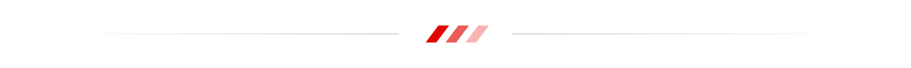
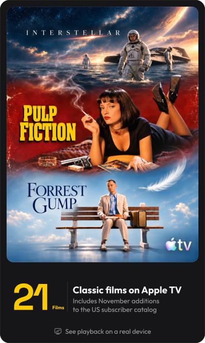
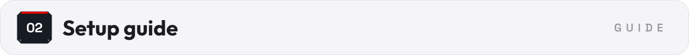
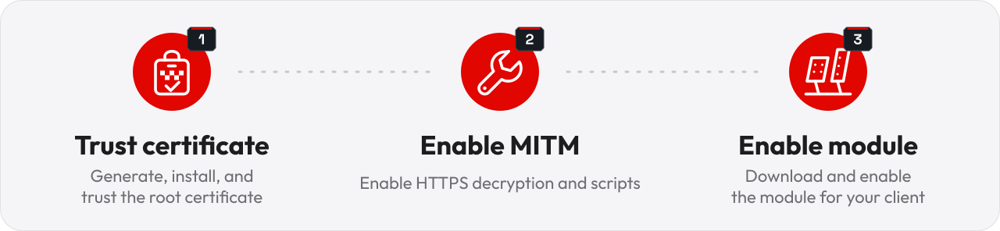
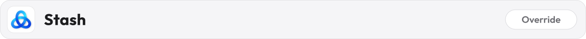
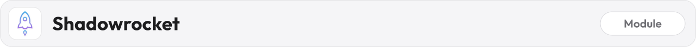
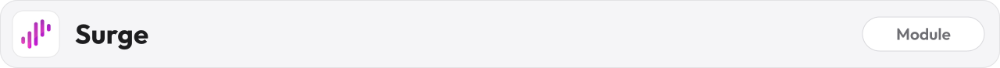

<p align="center"><a href="README.md">简体中文</a> · <a href="README.zh-Hant.md">繁體中文</a> · <a href="README.en.md">English</a> · <a href="README.ja.md">日本語</a></p>

<p align="center">
<picture>
  <source media="(max-width: 1279px) and (prefers-color-scheme: dark)" srcset="assets/readme/en/hero-mobile-dark.svg">
  <source media="(max-width: 1279px)" srcset="assets/readme/en/hero-mobile.svg">
  <source media="(prefers-color-scheme: dark)" srcset="assets/readme/en/hero-dark.svg">
  
</picture>
</p>

<p align="center">
<a href="https://apps.apple.com/us/app/dnspeed/id6810977106" title="About DNSpeed">
<picture>
  <source media="(max-width: 1279px) and (prefers-color-scheme: dark)" srcset="assets/readme/en/dnspeed-banner-mobile-dark.svg">
  <source media="(max-width: 1279px)" srcset="assets/readme/en/dnspeed-banner-mobile.svg">
  <source media="(prefers-color-scheme: dark)" srcset="assets/readme/en/dnspeed-banner-dark.svg">
  
</picture>
</a>
</p>

<p align="center"></p>

<p id="content" align="center">
<picture>
  <source media="(max-width: 1279px) and (prefers-color-scheme: dark)" srcset="assets/readme/en/h-content-mobile-dark.svg">
  <source media="(max-width: 1279px)" srcset="assets/readme/en/h-content-mobile.svg">
  <source media="(prefers-color-scheme: dark)" srcset="assets/readme/en/h-content-dark.svg">
  
</picture>
</p>

<p align="center">
<a href="https://www.xiaohongshu.com/explore/6adcb90e000000002c012bc6?xsec_token=ABu1J6OT5gks2uuoViYBbaU0MLs_bbMllNuaAx9rTjpo8=&amp;xsec_source=pc_search" title="See playback on a real device"><picture><source media="(max-width: 1279px) and (prefers-color-scheme: dark)" srcset="assets/readme/en/content-f1-mobile-dark.svg"><source media="(max-width: 1279px)" srcset="assets/readme/en/content-f1-mobile.svg"><source media="(prefers-color-scheme: dark)" srcset="assets/readme/en/content-f1-dark.svg"></picture></a><a href="https://www.xiaohongshu.com/explore/6ae9f7ec00000000030066fe?xsec_token=ABoB_t5zavPzsRDsfnqCvZDMVGuzU65QAqOs3HzTqIaQA=&amp;xsec_source=pc_search" title="See playback on a real device"><picture><source media="(max-width: 1279px) and (prefers-color-scheme: dark)" srcset="assets/readme/en/content-movie-mobile-dark.svg"><source media="(max-width: 1279px)" srcset="assets/readme/en/content-movie-mobile.svg"><source media="(prefers-color-scheme: dark)" srcset="assets/readme/en/content-movie-dark.svg"></picture></a>
</p>

<p align="center"></p>

<p id="guide" align="center">
<picture>
  <source media="(max-width: 1279px) and (prefers-color-scheme: dark)" srcset="assets/readme/en/h-guide-mobile-dark.svg">
  <source media="(max-width: 1279px)" srcset="assets/readme/en/h-guide-mobile.svg">
  <source media="(prefers-color-scheme: dark)" srcset="assets/readme/en/h-guide-dark.svg">
  
</picture>
</p>

<p align="center">
<picture>
  <source media="(max-width: 1279px) and (prefers-color-scheme: dark)" srcset="assets/readme/en/steps-mobile-dark.svg">
  <source media="(max-width: 1279px)" srcset="assets/readme/en/steps-mobile.svg">
  <source media="(prefers-color-scheme: dark)" srcset="assets/readme/en/steps-dark.svg">
  
</picture>
</p>

<p align="center"><a href="https://www.behoss.com/insights/library/2026-09-12-apple-video-subtitles-installation-guide/"></a></p>

<h3 align="center">
<picture>
  <source media="(max-width: 1279px) and (prefers-color-scheme: dark)" srcset="assets/readme/en/c-stash-mobile-dark.svg">
  <source media="(max-width: 1279px)" srcset="assets/readme/en/c-stash-mobile.svg">
  <source media="(prefers-color-scheme: dark)" srcset="assets/readme/en/c-stash-dark.svg">
  
</picture>
</h3>

```text
https://raw.githubusercontent.com/rexchen1803/apple-video-subtitles/main/stash/apple-video-subtitles.stoverride
```

<h3 align="center">
<picture>
  <source media="(max-width: 1279px) and (prefers-color-scheme: dark)" srcset="assets/readme/en/c-shadowrocket-mobile-dark.svg">
  <source media="(max-width: 1279px)" srcset="assets/readme/en/c-shadowrocket-mobile.svg">
  <source media="(prefers-color-scheme: dark)" srcset="assets/readme/en/c-shadowrocket-dark.svg">
  
</picture>
</h3>

```text
https://raw.githubusercontent.com/rexchen1803/apple-video-subtitles/main/shadowrocket/apple-video-subtitles.module
```

<h3 align="center">
<picture>
  <source media="(max-width: 1279px) and (prefers-color-scheme: dark)" srcset="assets/readme/en/c-quantumultx-mobile-dark.svg">
  <source media="(max-width: 1279px)" srcset="assets/readme/en/c-quantumultx-mobile.svg">
  <source media="(prefers-color-scheme: dark)" srcset="assets/readme/en/c-quantumultx-dark.svg">
  
</picture>
</h3>

```text
https://raw.githubusercontent.com/rexchen1803/apple-video-subtitles/main/quantumultx/apple-video-subtitles.snippet
```

<h3 align="center">
<picture>
  <source media="(max-width: 1279px) and (prefers-color-scheme: dark)" srcset="assets/readme/en/c-surge-mobile-dark.svg">
  <source media="(max-width: 1279px)" srcset="assets/readme/en/c-surge-mobile.svg">
  <source media="(prefers-color-scheme: dark)" srcset="assets/readme/en/c-surge-dark.svg">
  
</picture>
</h3>

```text
https://raw.githubusercontent.com/rexchen1803/apple-video-subtitles/main/surge/apple-video-subtitles.sgmodule
```

<p align="center"></p>

<p id="community" align="center">
<picture>
  <source media="(max-width: 1279px) and (prefers-color-scheme: dark)" srcset="assets/readme/en/h-support-mobile-dark.svg">
  <source media="(max-width: 1279px)" srcset="assets/readme/en/h-support-mobile.svg">
  <source media="(prefers-color-scheme: dark)" srcset="assets/readme/en/h-support-dark.svg">
  
</picture>
</p>

<p align="center">
<picture><source media="(max-width: 1279px)" srcset="assets/readme/en/thanks-mobile.svg"></picture>
</p>

<p align="center">
<a href="https://x.com/rexchen1803"><picture><source media="(max-width: 1279px) and (prefers-color-scheme: dark)" srcset="assets/readme/en/s-x-mobile-dark.svg">
  <source media="(max-width: 1279px)" srcset="assets/readme/en/s-x-mobile.svg">
  <source media="(prefers-color-scheme: dark)" srcset="assets/readme/en/s-x-dark.svg"></picture></a>
<a href="https://t.me/rexchen26"><picture><source media="(max-width: 1279px) and (prefers-color-scheme: dark)" srcset="assets/readme/en/s-tg-mobile-dark.svg">
  <source media="(max-width: 1279px)" srcset="assets/readme/en/s-tg-mobile.svg">
  <source media="(prefers-color-scheme: dark)" srcset="assets/readme/en/s-tg-dark.svg"></picture></a>
<a href="https://rexchen.si"><picture><source media="(max-width: 1279px) and (prefers-color-scheme: dark)" srcset="assets/readme/en/s-site-mobile-dark.svg">
  <source media="(max-width: 1279px)" srcset="assets/readme/en/s-site-mobile.svg">
  <source media="(prefers-color-scheme: dark)" srcset="assets/readme/en/s-site-dark.svg"></picture></a>
</p>
